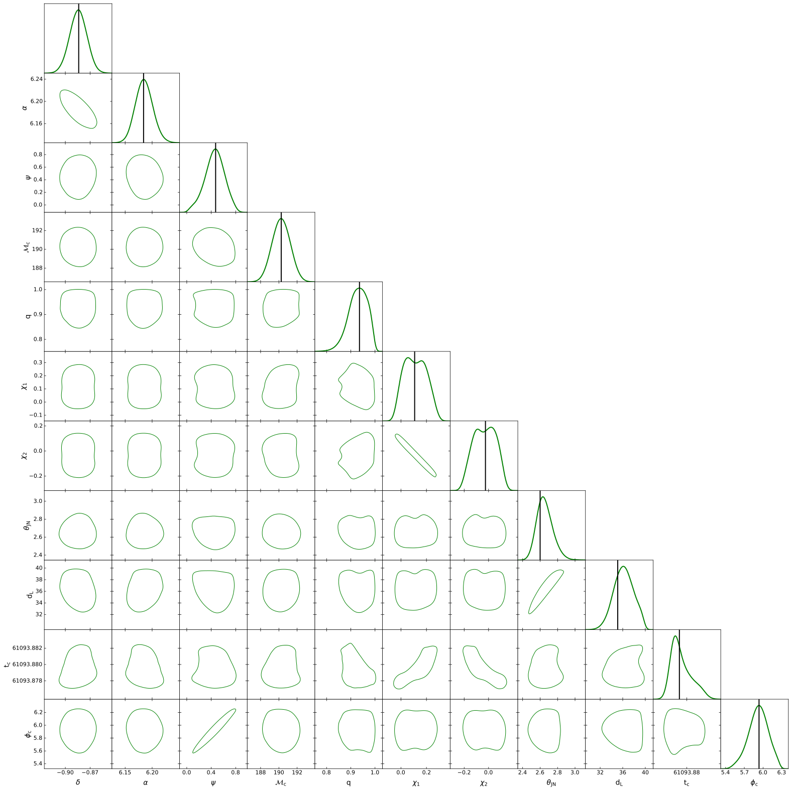

.. _sampling:

Likelihood sampling tutorial
============================

In section :ref:`dali_tensors` we have discussed how to calculate the ``DALI`` tensors and their Taylor form. 
In this section, assuming we have already performed such calculations we will discuss how 
to sample the ``DALI`` likelihood in the Python part of the framework.

``Taylor_DeltaPs`` Function
-----------------------

The ``DALI`` likelihood depends on the ``DALI`` tensors and their contraction 
with :math:`\Delta \theta^i`. The latter is calculated with the function ``Taylor_DeltaPs``.
This function takes as input :math:`\Delta \theta^i`, in the form of a ``numpy`` 
array, and an integer ``N`` and returns the powers 
:math:`\{\Delta \theta^{i_1 i_2}, \dots ,\Delta \theta^{i_1 ... i_{2 N}} \}`:

.. code-block:: python

   import symdali
   import numpy as np

   # Delta theta array
   delta_theta = np.array([0.1, 0.2, 0.3, 0.4, 0.5])

   # Calculate up to the power theta^6:
   N = 3
   delta_ps = symdali.Taylor_DeltaPs(delta_theta, N)

If we look at the output ``delta_ps`` we will see that it is a 1D ``numpy`` array 

.. code-block:: python

   print(len(delta_ps))
   >> 456

The number of elements is the sum ``456 == 15 + 35 + 70 +126+210``, the number of LI components
of totally symmetric tensors of ranks (2,3,4,5,6) in 5 dimensions. The function
``Taylor_DeltaPs`` gives a representation of

.. math::

   \Big\{& \\
        &\quad \Delta \theta^{ij},  \\
        &\quad \Delta \theta^{ijk}, \\
        &\quad \Delta \theta^{ijkl} \\
        &\quad \Delta \theta^{ijklm} \\
        &\quad \Delta \theta^{ijklmn} \\
   \Big\}&,

where the different powers of :math:`\Delta \theta^i` are represented by their LI components.
Once we have the powers of :math:`\Delta \theta^i` and the Taylor form of the ``DALI`` 
tensors obtained in :ref:`dali_tensors_ex` we can implement the ``DALI`` likelihood by taking the dot product
of these vectors. For instance, given the form of ``DALI`` tensors saved in :ref:`dali_tensors_ex` 
we have

.. code-block:: python
   
   #the fiducial point around which we expanded likelihood
   pf = np.array([
      -0.883787, 6.18412, 0.471846, 190.258, 0.935815, 0.107562, 
      -0.0254365, 2.60021, 35.1128, 61093.87906420612, 5.93578
   ])
   
   #Change dL -> 1/dL
   pf2 = pf.copy()
   pf2[8] = 1/pf[8]

   tensors = np.loadtxt('taylor.txt')

   def DALI_L(p):

       #Change dL -> 1/dL
      i_p = p.copy()
      i_p[8] = 1 / p[8]
       
      Delta_theta = i_p - pf2

      log_L = np.dot(
         symdali.Taylor_DeltaPs(Delta_theta, 3),
         tensors
      )
      
      return log_L

Here we make two important observations: as we saw in :ref:`fisher_tutorial` the derivatives are calculated
in :math:`1/d_L`, whereas we want to sample the likelihood in :math:`d_L`, so we perform
a coordinate change inside the function. Also, it is necessary to pass the vector `p` in the
same order of the variable derivatives calculated in :ref:`dali_tensors` that is: 

.. math::
   p = \left(\text{dec}, \text{phi}, \text{psi}, \text{Mc}, \text{q}, \text{s1z}, \text{s2z}, \text{iota}, \text{dL}, \text{tc}, \text{phiRef} \right)

The function ``DALI_L(p)`` already implements the ``DALI`` likelihood and can be used to
perform the sampling, which can be done with any algorithm. In practice we advise the use 
of ``emcee`` because it is lightweight. In the following we describe our way of using it.

Sampling
--------

The priors in GWs can be defined in very different scales we find it useful to 
transform the sampling problem to a cube. We choose the cube length to be 200, so that 
the step size of ``emcee``, ``a=1``, is small with respect to the cube's length
scale. In order to perform such a change we need two functions to convert variables from 
the cube to the actual prior ranges and vice versa. Assume that ``a`` and ``b`` have the 
boundaries of the waveform variables:

.. code-block:: python
   
   a = np.array([
      -np.pi/2, 0., 0., # dec, phi, psi
      140, 0.125, -0.99, -0.99, # Mc, q, s1z, s2z
      0., 1, 61094.012-0.2, 0 # iota, dL, tc, phi_ref
   ])

   b = np.array([
      np.pi/2, 2*np.pi, np.pi, # dec, phi, psi
      240., 1., 0.99, 0.99, # Mc, q, s1z, s2z
      np.pi, 40., 61094.012 + 0.2, 2*np.pi # iota, dL, tc, phi_ref
    ])

We define functions to take a variable :math:`x \in \left[a, \, b \right]` to :math:`y \in \left[0, 200 \right]`
and to take the variable :math:`y` back to :math:`x`:

.. code-block:: python

   #Define transformations to the cube and from it:
   cube_length=200

   inv_scale = cube_length / (b - a)

   scale = (b - a) / cube_length

   def from_cube(y):
      return y * scale + a

   def to_cube(x):
      return (x - a) * inv_scale

Now we define the likelihood that takes the cube variables:

.. code-block:: python

   def emcee_logP(y):
      if y.min() < 0 or y.max() > 200:
         return -np.inf

      return DALI_L(from_cube(y))

Finally, we just proceed to likelihood sampling:

.. code-block:: python

   #Here we set the walkers and initial steps
   p0 = np.random.uniform(0, 200, size=(100, 11))
   nwalkers, ndim = p0.shape

   #RUN EMCEE
   import emcee
   sampler = emcee.EnsembleSampler(nwalkers, ndim, emcee_logP, a=1)

   sampler.run_mcmc(p0, int(5e5), progress=False);

   #Calculate the auto correlation time
   tau = sampler.get_autocorr_time()

   # the emcee recomendation is to discard 2xtau and thin the chain by tau/2
   flat_samples = sampler.get_chain(
      discard=int(2*tau.max()), 
      thin=int(tau.max()/2), 
      flat=True
   )

   #The samples are in the cube variables y in (0,200)
   # Here we transform them back to the original intervals
   flat_samples = from_cube(flat_samples)

Finally, we look at the corner plot of the result: 

.. code-block:: python

   import getdist
   from getdist import plots

   #observe that for the injection value of t_c the right ascension and azimuthal angle 
   #are equivalent
   labels = [
      'dec', 'ra', 'psi',
      'chirp_mass', 'mass_ratio','chi_1', 'chi_2', 
      'theta_jn', 'luminosity_distance', 'geocent_time', 'phase'
   ]

   latex_labels = [
      r'\delta', r'\alpha', r'\psi',
      r'\mathcal{M}_c', 'q', r'\chi_1', r'\chi_2', 
      r'\theta_{JN}', r'd_L', r't_c', r'\phi_c'
   ]

   samples = getdist.MCSamples(
      samples=flat_samples, 
      names = labels, 
      labels = latex_labels,
      label='Triplet'
   )

   samples.smooth_scale_1D = 0.3
   samples.contours = [0.9]

   g = plots.get_subplot_plotter(scaling=False)
   g.settings.figure_legend_frame = False
   g.settings.legend_fontsize = 50

   g.triangle_plot(
      [samples],
      filled=False,
      contour_colors=['g'],
      line_args = [
         {'lw':2, 'color':'g'}
      ],
      legend_loc='upper right',
      marker_args={'lw': 2,'color':'r', "alpha":1},
   )

   leg = g.fig.legends[0]
   for line in leg.get_lines():
      line.set_linewidth(5)

   # add truth only to 1D panels (diagonal)
   pf = dict(zip(labels, pf))
   truth = pf

   for i, p in enumerate(list(pf.keys())):
      ax = g.subplots[i, i]   # diagonal axis
      ax.axvline(truth[p], color='k', lw=2)

   fig = g.fig

   plt.savefig('example.pdf', dpi=300, bbox_inches='tight')

As shown in Figure 5 in `2609.38399 <https://arxiv.org/abs/2609.38399>`_ this example
has good agreement with the result of the exact likelihood, which takes around 69 hours
to run.

`Here <https://github.com/Felipe-4/SymDALI/tree/main/Demo/Terminal_workflow>`_, 
we have a Wolfram Language, Python and Bash scripts that 
demonstrate the complete workflow, from the ``DALI`` tensors to the final plot with a 
single terminal command. On a Macbook Air M1 with 8 Gb of RAM this example takes 12.3 minutes to run.

